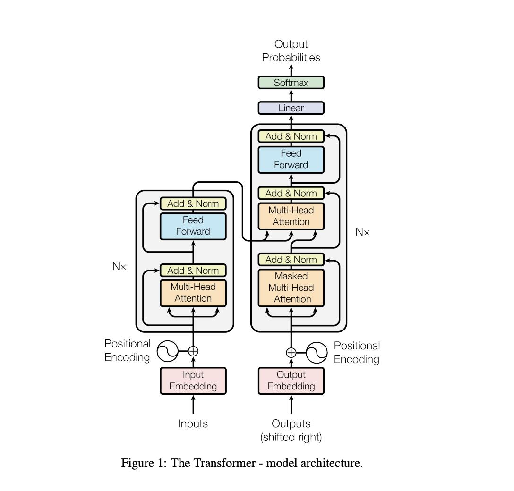
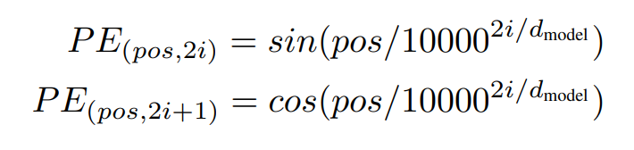
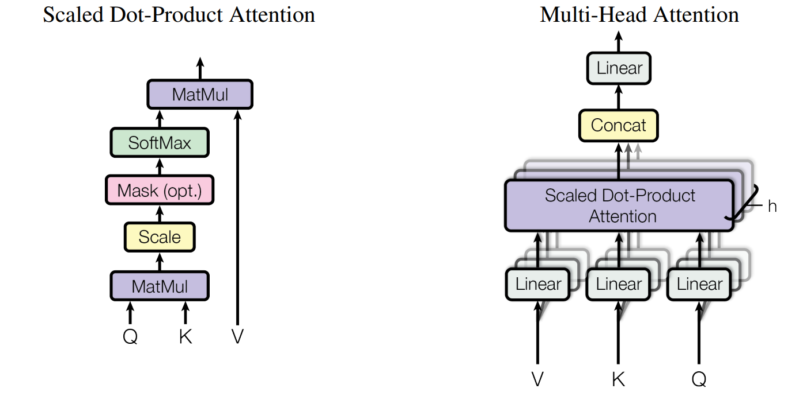
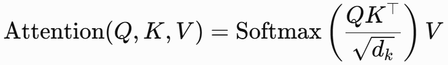
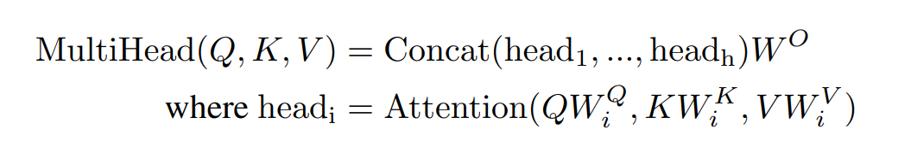
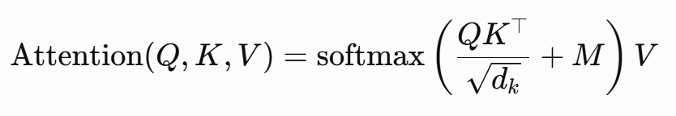
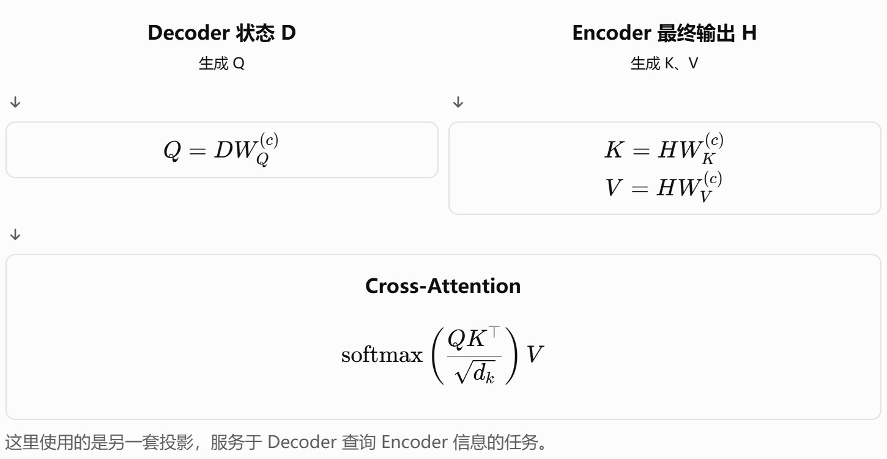

# Task1 对《Attention Is All You Need》的学习及对Transfomer的理解

## 一，Transformer 的结构及对各部分的阐释

Transformer 的架构主要由 Encoder & Decoder 两部分组成，Encoder 负责将输入内容转化成内部表示，得到模型可用的上下文信息；Decoder 负责结合 Encoder 生成的上下文信息和目标序列（已经输出的序列部分再作为输入），输出下一个词的可能性。

论文中的结构图已经将结构表示的很完整，一个block即一个灰框内的内容。**接下来我就对各个部分做具体详细的阐述（没有按照论文的介绍顺序而是按照网络层的顺序，我觉得这样更易于理解）**：

### （1）Encoder

#### 1.Embedding 词嵌入

为了把文本信息转换成模型可学习的形式，Embedding 将词元映射成向量形式，向量内部的参数可以训练。

#### 2. Positional Encoding 位置编码

**必要性：** Transfomer 没有使用RNN、CNN，那么为了知道词语的位置信息，需要加上**位置编码**来表示出位置关系。
PE的计算公式：

- 使用sin与cos交替：形成更丰富的位置编码关系（其实我并不太了解这其中的数学原理）（原文：We chose the sinusoidal version because it may allow the model to extrapolate to sequence lengths longer than the ones encountered during training. 即，作者认为这样表示能处理更长的句子。）
- E + PE ：把词元内容和位置信息加在一起，这样既可以把内容和位置一起考虑，而且不用增加维度。

#### 3. Multi-Head Attention 多头注意力机制

**注意力机制**的本质是让不同位置关注不同的上下文并吸收有用信息，从而生成适合当前任务的表示。

**Q、K、V的含义：**

- Q：query查询，代表这个词元想要寻找什么信息；
- K：key键，提供用于匹配的信息。
- V：value值，代表词元本身的内容信息。

Q、K、V共同完成了词元信息的加工、词元间信息的交互、聚合最终信息的工作。

**在第4节 why Self-Attention 中作者讲到了采用注意力机制的原因：**

- 作者考虑到的三个标准：每层总计算的复杂度、能并行化多少运算、长距离依赖的路径长度。
- 对比 RNN：RNN 有串行依赖，即后面输出总依赖于前面；而注意力机制可以一次计算所有位置间的注意力分数，并行运算。
- 对比卷积：由于卷积核的宽度有限，较远词元就难以产生直接联系，且计算成本较高；可分离卷积虽然可以减少计算量，但仍然和作者所用的一个注意力层、一个FFN层计算量相当。
- 额外的好处，增强了模型的可解释性：作者检查了模型中的注意力分布，发现不同的注意力头显然学会了执行不同的任务，而且其中许多注意力头所表现出的行为似乎还与句子的句法结构和语义结构有关。

**下面是 Attention 的结构：**

**一个 Scaled Dot-Product Attention :**
注意力分数的计算公式为：

- 将由词元各计算得到的 Q 矩阵与 K 矩阵的转置相乘，可得到代表各个词元之间的**相关性**的矩阵，并对其做softmax以得到**注意力权重**；
- 再将这个权重与 V 矩阵相乘，可得到各个词元信息的**注意力分数**。

而 **Multi-Head Attention** 则是把多个 Scaled Dot-Product Attention 拼接（concat）：

**Multi-Head Attention 的好处：**
一个单头 Attention 只用了一组 Q，K，V，相当于只学习到了一种词元间的联系方式；而多头 Attention 用了多组 Q，K，V（在不同的表示子空间中学习关系），可以并行地学习不同的关联模式，让模型获得更丰富的上下文信息，从而**增强模型对复杂上下文的表达能力**（尽管最后输出的维度都是512，但是多头的计算方式使得它的确能够表达比单头更多种的关系）。

#### 4. Residual Connection 残差连接

**残差连接**即绕过中间某些网络层直接与这些层的输出相加的结构，用于让模型学习在原有基础上改变内容。
公式：Y = X + F(X)

- why：可以保留原有信息；并且残差连接可以解决出现深层梯度消失的情况，为梯度传播提供一条更直接的路径，让模型训练变得更容易。

#### 5. Position-wise Feed-Forward Network (FFN) 前馈神经网络

FFN主要由线性变换层 Linear 和激活层组成，输入输出维度均为512，隐藏层维度2048。
Position-wise：所有位置参数共享，即对每一个位置（同一个 FFN 层内的所有词元）实现相同的线性变换和相同的激活函数。这样做的好处是：可以减少参数量；让模型对所有位置采用相同的特征处理规则；并且可以并行计算。

作者还说：本层可以用一个1\*1卷积代替。

**FFN层的作用：** 加在注意力层之后，相当于对注意力层得到的关系特征进一步加工，加强模型对语义与结构的理解，学习到更复杂更深入的特征。

#### 6. LayerNorm 层归一化

层归一化包含：

- 归一化：Z-score，变成均值为 0、方差约为 1 。
- 缩放平移（选择性加入）：加入可学习参数（如缩放系数，偏置等），调整归一化之后的结果。

作用：调整数值的分布，提升训练的稳定性。

### （2）Decoder

Decoder的大部分结构与Encoder的相近，不同的主要是输入以及两个 Self-Attention 层上的区别。

#### 1. 输入

Encoder的输入是模型读到的文本，而Decoder的输入是前面已经生成的内容。
训练阶段 Decoder 直接使用正确序列作为输入，避免因为上一步生成错误导致后面连错，以提高训练效率（即Teacher forcing）；而测试阶段则只能使用模型前面自己生成的内容，模拟实际的生成情况。

但是这就关系到自回归模型中的一个问题：**暴露偏差 （Exposure Bias）**，训练和推理的方式不一样，导致准确率等上面出现差异。
本文的Transfomer并没有解决这个问题。下面是我**粗略了解的一些解决方法**：

- Scheduled Sampling（计划采样）：训练过程中，不再始终使用真实的历史词元，而是逐渐增加使用模型自身预测结果的比例，学习在不完美历史输入下的生成。但是也有局限性，可能引入错误标签或不稳定的训练信号；在某些设置下也存在目标不一致的问题，并非必然优于标准训练。
- Sequence-Level Training（序列级训练）：标准训练通常在每个位置计算词元级损失；序列级训练则尝试直接优化整个生成序列的质量，例如翻译质量或任务评价指标。典型方法包括强化学习中的策略梯度，以及使用 BLEU 等指标构造的优化目标。局限是序列级奖励可能比较稀疏，训练方差较大，优化过程也更复杂。
- 直接让模型学习纠正错误历史：可以通过构造包含错误、噪声或不完整历史的训练样本，让模型学习在历史输入不完美时如何继续生成。
- Beam Search（束搜索）：在生成时保留多个候选序列，而不是只保留当前概率最高的一个候选，以降低贪心解码过早选错的风险。局限是它并没有从根本上消除暴露偏差。束搜索也可能保留错误路径，且不一定改善所有模型和任务的最终质量。

#### 2. Mask 掩码

掩码是注意力机制中规定哪些位置可以被关注、哪些位置不能被关注的操作。常见的 Mask 有两种：

- Padding Mask：一个 batch 中通常句子长度不同，为了让他们组成统一形状的张量可以在短句子后面padding 填充；在模型计算时就需要把这些填充的字符屏蔽掉。
- Casual Mask（也叫 Look-ahead Mask）（因果掩码）：在训练时，理论上模型应该根据当前生成位置之前的信息来生成，所以需要屏蔽掉其后的、未来的 Token 保证生成时根据前文序列生成。

**掩码的具体操作：** 构造矩阵 M，把需要掩盖部分的分数设为负无穷（通常用一个很小的负数代替）其余设为0，再与注意力分数矩阵相加，并做softmax，这样需要屏蔽的位置就得到0权重。
写成公式就是：

这中0和负无穷的掩码方式为**硬掩码**，也是本Transformer使用的。除此之外还有：

- 软掩码：不使用负无穷而是使用一个有限的负数，降低对它的关注度；
- 注意力偏置 Attention Bias：与掩码相反，它通过加正数来提高某些位置的关注度。

Decoder 中的 Masked Attention 主要是指使用了 Casual Attention，保证训练中生成时模型只能看到已有信息。（Padding Mask 应该也会有使用到，只是文章好像没有特别说到）

#### 3. Cross-Attention

Cross-attention 常用于 Encoder-Decoder 架构中，同时考虑到了 Encoder 输出的上下文信息和 Decoder 已生成序列的信息，Decoder提供 Query，Encoder提供 Key 和 Value，从而建立起两者之间的联系。
**Cross-attention 作用：** 建立两者之间的联系，有助于模型保持源句与目标句之间的语义联系，并且每个位置读取到的注意力分布不同，故可以动态聚合上下文信息。

- 但是我学到这里其实会有问题：Encoder的最终输出不是已经是一个算好的注意力输出了吗？K和V又从哪里来呢？
  这就涉及其具体过程：
  Cross-Attention 会对 Q、K、V 各有一个投影矩阵，分别与 Decoder 的输出 D 与 Encoder 的输出 Z 相乘，重新生成Q、K、V。下面是GPT给我画的示意图：
  

### （3）Loss 的计算

这部分好像没有要求提交，但是我觉得有必要了解，这里我就简单呈现一下。

语言模型的 Loss 通常不是来自整个句子，而是来自许多 Token 预测任务的损失汇总，使用的是预测 Token 的概率大小计算 loss。所以最常用的 Loss 函数是**交叉熵损失**。
交叉熵并不是简单地计算预测词和正确词是否相同，而是模型给正确词元分配了多少概率，即使模型最终选中了正确的词，如果它给正确答案的概率不够高，Loss 仍然可能比较大。
训练阶段：通常已经知道完整的正确文本，因此可以并行计算各个位置的loss。
测试阶段：只能模型逐个生成词元，需要一个一个算loss。

## 二，对问题的解答

各个问题的详细阐述其实在上文已经完成，下面只做总结性的答题。

1. 解释为什么 Decoder 中需要 Causal / Masked Attention：
   因为实际预测词元时只能知道已经生成的词元，并不能看到未来的序列，所以输出时需要限制每个位置只能关注当前及之前的位置，不能关注未来的位置，才能达到生成的训练效果。

2. 解释 Multi-Head Attention 与单头 Attention 的区别：
   单头 attention 只使用了一套Q、K、V，直接用一整个512维度，相当于只学习了一种关系；
   而多头 attention 将512维拆成多头，每个头都各用一套自己的Q、K、V，相当于学习了多种关系，并且作者测试后发现的确多头 attention 能够表示更丰富、更复杂的关系，模型效果更好。

3. 说明 Attention、MLP、Residual Connection、LayerNorm 各自承担什么功能：

- Attention：承担了交换词元信息，建立起词元间语义联系的功能。
- MLP：这里的 MLP 就是指 FFN，承担的是对特征进行非线性变换加工，进一步描述词元复杂信息的功能。
- Residual Connection：承担了保留原有信息，并让梯度更容易传播的功能。
- Layer Normalization：承担了规范化特征的数值分布，帮助训练更稳定的功能。
