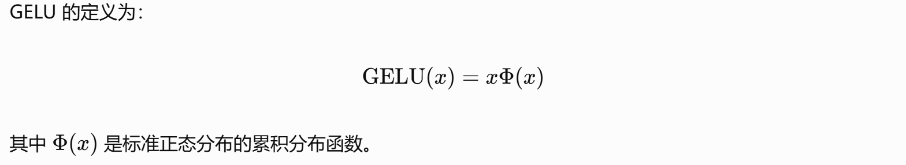

# Task2 对源码的理解

## 一，项目结构

- model.py：GPT 模型的结构定义，包含 Casual Self-Attention 、LayerNorm、MLP 以及一个 Block 的结构和 GPT 的总结构等。
- train.py：训练的入口，读取训练数据，创建模型和优化器，计算 Loss、反向传播、更新参数，并定期评估和保存模型。
- sample.py：可加载训练好的模型和参数，提供初始文本，是生成文本的地方。
- configurator.py：读取默认配置、配置文件以及命令行参数，确定本次训练或生成使用哪些参数。
- data/：存放不同数据集的预处理脚本、数据下载脚本以及处理后的数据文件等。
- config/：存放针对不同数据集、训练任务或模型设置的配置文件。

## 二，nanoGPT 模型结构

### 这部分我以源码对应部分 + 理解阐述的形式呈现，代码中包含了我自己做的一些批注（这个主要是我自己理解用，不方便看的话可以不看）。

### 1. Token Embedding & 2. Position Embedding

- 初始化：

```python
self.transformer = nn.ModuleDict(dict(##nn.ModuleDict：PyTorch 提供的模块字典，用来组织多个神经网络子模块
            wte = nn.Embedding(config.vocab_size, config.n_embd),#Word Token Embedding 的缩写，表示词元嵌入层（词表大小，特征维度）
            wpe = nn.Embedding(config.block_size, config.n_embd),#Word Position Embedding 的缩写，表示位置嵌入层（模型支持的序列长度上限，特征维度）
            ##词元嵌入 + 位置嵌入，再将两者相加
            drop = nn.Dropout(config.dropout),
            h = nn.ModuleList([Block(config) for _ in range(config.n_layer)]),##把所有 Transformer Block 按顺序组织起来
            ln_f = LayerNorm(config.n_embd, bias=config.bias),##Final Layer Normalization，最终层归一化。
            # LayerNorm 会沿着最后一个特征维度进行计算，对每个位置的特征维度进行归一化，再使用可学习的缩放参数和偏移参数调整结果
        ))
```

- 前向传播中：

```python
pos = torch.arange(0, t, dtype=torch.long, device=device) # shape (t)
##设置位置索引

# forward the GPT model itself
tok_emb = self.transformer.wte(idx) # token embeddings of shape (b, t, n_embd)
pos_emb = self.transformer.wpe(pos) # position embeddings of shape (t, n_embd)
##转换成词元向量
x = self.transformer.drop(tok_emb + pos_emb)
```

词嵌入部分分别对词元和位置嵌入向量，然后对应向量（什么位置对什么词元）相加。（词嵌入的特征维度都是 n_embd，所以二者才能相加）

### 3. Transformer Block × N

**_一个 block：_** 依次运算：layernorm、Attention、residual connection、layernorm、MLP、residual connection。

```python
class Block(nn.Module):

    def __init__(self, config):
        super().__init__()
        self.ln_1 = LayerNorm(config.n_embd, bias=config.bias)
        self.attn = CausalSelfAttention(config)
        self.ln_2 = LayerNorm(config.n_embd, bias=config.bias)
        self.mlp = MLP(config)

    def forward(self, x):
        x = x + self.attn(self.ln_1(x))
        x = x + self.mlp(self.ln_2(x))
        return x
```

- LayerNorm

```python
class LayerNorm(nn.Module):
    """ LayerNorm but with an optional bias. PyTorch doesn't support simply bias=False """

    def __init__(self, ndim, bias):
        super().__init__()
        self.weight = nn.Parameter(torch.ones(ndim))
        self.bias = nn.Parameter(torch.zeros(ndim)) if bias else None

    def forward(self, input):
        return F.layer_norm(input, self.weight.shape, self.weight, self.bias, 1e-5)
```

LayerNorm 沿着特征维度对数值进行归一化，提高数值分布的稳定性。
这里设置了可以学习的缩放参数 weight 和偏置参数 bias，增强了模型的调整适应能力。

- Causal Self-Attention

```python
class CausalSelfAttention(nn.Module):

    def __init__(self, config):
        super().__init__()
        assert config.n_embd % config.n_head == 0               ###检查能不能整划分成注意力头
        # key, query, value projections for all heads, but in a batch

        self.c_attn = nn.Linear(config.n_embd, 3 * config.n_embd, bias=config.bias)
        ##把三次线性变换合并成一次计算，仍然拥有各自独立的权重矩阵，只是计算方式更紧凑。

        # output projection
        self.c_proj = nn.Linear(config.n_embd, config.n_embd, bias=config.bias)
        ##对拼接后的多头注意力结果做线性变换

        # regularization
        self.attn_dropout = nn.Dropout(config.dropout)
        self.resid_dropout = nn.Dropout(config.dropout)

        self.n_head = config.n_head
        self.n_embd = config.n_embd
        self.dropout = config.dropout

        # flash attention make GPU go brrrrr but support is only in PyTorch >= 2.0
        ### 这行代码检查当前PyTorch是否提供scaled_dot_product_attention函数。如果支持，就优先使用PyTorch的高效注意力实现；否则使用下面的手动计算版本。
        self.flash = hasattr(torch.nn.functional, 'scaled_dot_product_attention')
        if not self.flash:
            print("WARNING: using slow attention. Flash Attention requires PyTorch >= 2.0")
            # causal mask to ensure that attention is only applied to the left in the input sequence
            self.register_buffer("bias", torch.tril(torch.ones(config.block_size, config.block_size))
                                        .view(1, 1, config.block_size, config.block_size))


    def forward(self, x):
        B, T, C = x.size() # batch size, sequence length, embedding dimensionality (n_embd)

        # calculate query, key, values for all heads in batch and move head forward to be the batch dim
        q, k, v  = self.c_attn(x).split(self.n_embd, dim=2)
        ## 一次性计算并分开

        ##改变形状。它把最后的 768 维重新组织成 12 个头，每个头 64 维
        k = k.view(B, T, self.n_head, C // self.n_head).transpose(1, 2) # (B, nh, T, hs)
        q = q.view(B, T, self.n_head, C // self.n_head).transpose(1, 2) # (B, nh, T, hs)
        v = v.view(B, T, self.n_head, C // self.n_head).transpose(1, 2) # (B, nh, T, hs)

        # causal self-attention; Self-attend: (B, nh, T, hs) x (B, nh, hs, T) -> (B, nh, T, T)
        if self.flash:
            # efficient attention using Flash Attention CUDA kernels
            y = torch.nn.functional.scaled_dot_product_attention(q, k, v, attn_mask=None, dropout_p=self.dropout if self.training else 0, is_causal=True)
        else:
            # manual implementation of attention
            att = (q @ k.transpose(-2, -1)) * (1.0 / math.sqrt(k.size(-1)))
            att = att.masked_fill(self.bias[:,:,:T,:T] == 0, float('-inf'))
            att = F.softmax(att, dim=-1)
            att = self.attn_dropout(att)
            y = att @ v # (B, nh, T, T) x (B, nh, T, hs) -> (B, nh, T, hs)
        y = y.transpose(1, 2).contiguous().view(B, T, C) # re-assemble all head outputs side by side

        # output projection
        y = self.resid_dropout(self.c_proj(y))##加一个线性变换
        return y

```

Q、K、V的设置：这里用view把张量形状设置成了（B，nh，T，hs）（先拆了原来的特征维度 C，再交换了第1、2维的位置），即批次大小 Batch size、 注意力头数量 Number of heads、序列长度 Sequence length、每个注意力头的维度数 Head size。
attention 的计算则使用了 PyTorch 的函数 torch.nn.functional.scaled_dot_product_attention()，或者在低版本的环境使用手动计算。

- Residual Connection
  残差连接主要体现在：block 在运算时加上了 x 自身。

```python
def forward(self, x):
        x = x + self.attn(self.ln_1(x))
        x = x + self.mlp(self.ln_2(x))
        return x
```

- MLP
  这里使用了两个线性变换层，一个 fc 层，一个加工层，激活函数使用 GELU。

```python
class MLP(nn.Module):

    def __init__(self, config):
        super().__init__()
        self.c_fc    = nn.Linear(config.n_embd, 4 * config.n_embd, bias=config.bias)
        self.gelu    = nn.GELU()
        self.c_proj  = nn.Linear(4 * config.n_embd, config.n_embd, bias=config.bias)
        self.dropout = nn.Dropout(config.dropout)

    def forward(self, x):
        x = self.c_fc(x)
        x = self.gelu(x)
        x = self.c_proj(x)
        x = self.dropout(x)
        return x
```

**_激活函数 GELU：_**

直观上，它会根据输入值的大小，平滑地调整输入通过的程度。
与 ReLU 相比，GELU 并不是简单地把所有负数都变成 0,而是对负数通常保留一部分负值；它会根据输入的大小，连续地调整输入的幅度。GELU 的激活方式会更平滑，梯度更连续，能够对输入进行连续、细腻的调节。ReLU 采用了更简单、更直接的截断方式，而它在负半轴的梯度为 0，可能导致某些神经元长期无法恢复激活，即所谓的“死亡 ReLU”问题。GELU 通常能避免这种硬截断带来的问题，但不能保证训练中绝不会出现梯度或优化困难。

### 4. Final LayerNorm

```python
ln_f = LayerNorm(config.n_embd, bias=config.bias)
```

```python
        for block in self.transformer.h:
            x = block(x)
        x = self.transformer.ln_f(x)
```

Fanal LayerNorm 对经过多个 Block 后模型得到最终隐藏表示做归一化。
在每个 Block 中的 LayerNorm 是进行在 attention 和 MLP 之前的，所以最终的输出需要最后再归一化一次。

### 5. LM Head （Language Modeling Head 语言模型输出头）

在模型最后，LM Head 做一次 Linear 线性变换，将隐藏维度映射为词表大小，即把 Transformer 最后输出的隐藏向量转换成词表中每个词元对应的预测分数，从而用于预测下一个词元。

### 最终词元的生成过程：

```python
    def generate(self, idx, max_new_tokens, temperature=1.0, top_k=None):##生成，让 GPT 逐个 Token 生成文本，实现自回归文本生成
        """
        Take a conditioning sequence of indices idx (LongTensor of shape (b,t)) and complete
        the sequence max_new_tokens times, feeding the predictions back into the model each time.
        Most likely you'll want to make sure to be in model.eval() mode of operation for this.
        """
        for _ in range(max_new_tokens):##循环生成至最大生成词元数
            # if the sequence context is growing too long we must crop it at block_size
            idx_cond = idx if idx.size(1) <= self.config.block_size else idx[:, -self.config.block_size:]##裁剪
            # forward the model to get the logits for the index in the sequence
            logits, _ = self(idx_cond)
            # pluck the logits at the final step and scale by desired temperature
            logits = logits[:, -1, :] / temperature###温度的作用是调整 Softmax 之后概率分布的尖锐程度
            # optionally crop the logits to only the top k options
            if top_k is not None:###保留最有可能的几个
                v, _ = torch.topk(logits, min(top_k, logits.size(-1)))
                logits[logits < v[:, [-1]]] = -float('Inf')
            # apply softmax to convert logits to (normalized) probabilities
            probs = F.softmax(logits, dim=-1)
            # sample from the distribution
            idx_next = torch.multinomial(probs, num_samples=1)
            # append sampled index to the running sequence and continue
            idx = torch.cat((idx, idx_next), dim=1)##拼接到原序列

        return idx
```

裁剪：对生成的这个token序列裁剪，限制考虑到的上文长度不超过模型支持的最大长度；
生成logits、softmax转化成概率，并除以temperature改善概率分布的尖锐程度；
然后随机采样：按照这些概率来随机选择生成的下一个词元；
最后拼接到已经生成的序列后面形成序列。

- **为什么随机采样而不直接选用概率最高的token？**
  选择概率最高的token的方法称作贪心选择 Greedy Selection，这样会有一些问题：第一是语言多样性下降，二是可能当前概率最高的token不是最佳选择，可能选错。而随机采样虽然有时可能也没有贪心选择准确，却提供了生成语言的多样性。
  循环生成直至最大词元数。

### 优化器

```python
    def configure_optimizers(self, weight_decay, learning_rate, betas, device_type):
        # start with all of the candidate parameters
        param_dict = {pn: p for pn, p in self.named_parameters()}
        # filter out those that do not require grad
        param_dict = {pn: p for pn, p in param_dict.items() if p.requires_grad}
        # create optim groups. Any parameters that is 2D will be weight decayed, otherwise no.
        # i.e. all weight tensors in matmuls + embeddings decay, all biases and layernorms don't.
        decay_params = [p for n, p in param_dict.items() if p.dim() >= 2]
        nodecay_params = [p for n, p in param_dict.items() if p.dim() < 2]
        optim_groups = [
            {'params': decay_params, 'weight_decay': weight_decay},
            {'params': nodecay_params, 'weight_decay': 0.0}
        ]
        num_decay_params = sum(p.numel() for p in decay_params)
        num_nodecay_params = sum(p.numel() for p in nodecay_params)
        print(f"num decayed parameter tensors: {len(decay_params)}, with {num_decay_params:,} parameters")
        print(f"num non-decayed parameter tensors: {len(nodecay_params)}, with {num_nodecay_params:,} parameters")
        # Create AdamW optimizer and use the fused version if it is available
        fused_available = 'fused' in inspect.signature(torch.optim.AdamW).parameters
        use_fused = fused_available and device_type == 'cuda'
        extra_args = dict(fused=True) if use_fused else dict()
        optimizer = torch.optim.AdamW(optim_groups, lr=learning_rate, betas=betas, **extra_args)
        print(f"using fused AdamW: {use_fused}")

        return optimizer
```

模型的优化器使用了 AdamW 优化器，即 Adam with decoupled Weight Decay（带解耦权重衰减的 Adam 优化器）。
优化前把参数分成了两组：dim() >= 2：归入需要权重衰减的组；dim() < 2：归入不使用权重衰减的组。即，对矩阵类权重使用了权重衰减，而对偏置和 LayerNorm 等一维参数不使用权重衰减。

- **权重衰减 Weight Decay**：正则化手段，对使用了权重衰减的参数在梯度更新上额外施加一种收缩效果，降低过拟合风险。

## 三，Tensor Shape 追踪

**_我使用了 train.py 里面提供的数值：_**
B batch size = 12
T sequence length = 1024
C embedding dimension = 768
n_head attention heads = 12

**_追踪：_**

1. 由输入 idx 得到 shape size,(B,T)=(12,1024)

2. Token Embedding & Position Embeddingx后增加一个维度，(B,T,C)=(12,1024,768)

3. 生成 Q，K，V：这里他先并行计算再沿 C 维度分开成三部分，即(B,T,C)=(12,1024,3\*768)---**split**--->3\*(12,1024,768)

4. 分成多头：用 view 改变形状成(B, T, nh, hs)，即将 c 维分成注意力头数\*每头维度数 **（为什么成立：原来的 C 维度数量能被注意力头数 n_head 整除，且view前后总元素数量不改变）**；
   然后 transpose 第1，2维变成(B, nh, T, hs)=(12,12,1024,64)

5. attention matrix:
   先是 Q 与 K 的转置相乘，(B, nh, T, hs) x (B, nh, hs, T) -> (B, nh, T, T)=(12,12,1024,1024)**（相当于后两个维度组成的矩阵相乘）**；
   然后是这个结果与 V 相乘(B, nh, T, T) x (B, nh, T, hs) -> (B, nh, T, hs)=(12,12,1024,64)

6. attention output：
   transpose 将第1，2维交换变成(B,T,nh,hs)（这样方便view合并）,
   view 将nh、hs合并回 (B,T,C)=(12,1024,768)**（为什么成立：改变前后仍旧总元素数12\*12\*768不变，且每个层结束后变回C=768便于多个层、多个block之间传递）**

7. MLP input/output：(B,T,C)=(12,1024,768)--**Linear**-->(12,1024,4\*768)--**GELU,Linear**-->(12,1024,768) **（还是把 C 变回768）**

8. logits：经过一个 LM Head，将隐藏维度重新映射回词表大小 **（用于输出词表各词的分数以用于训练计算 loss 或生成文字时计算概率、预测下一个 token）**
