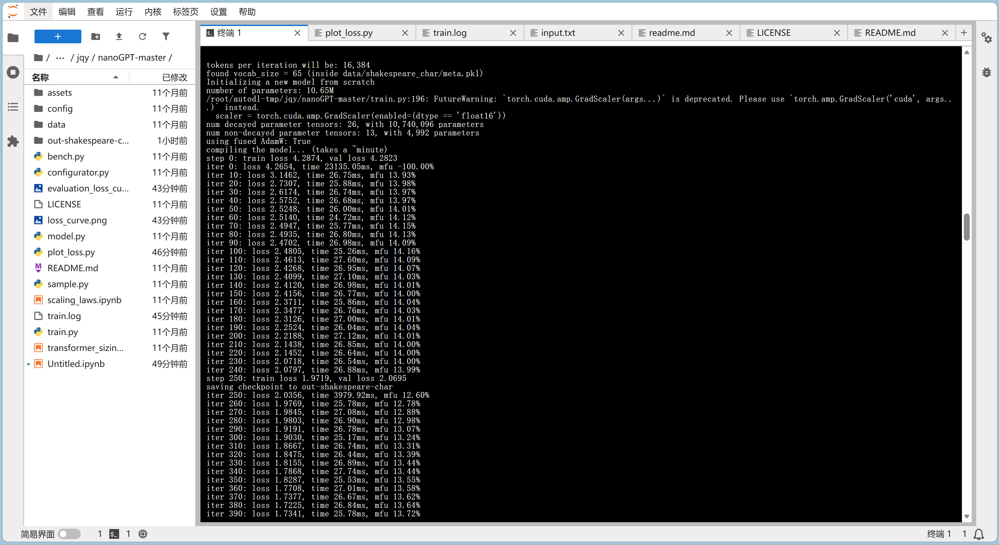
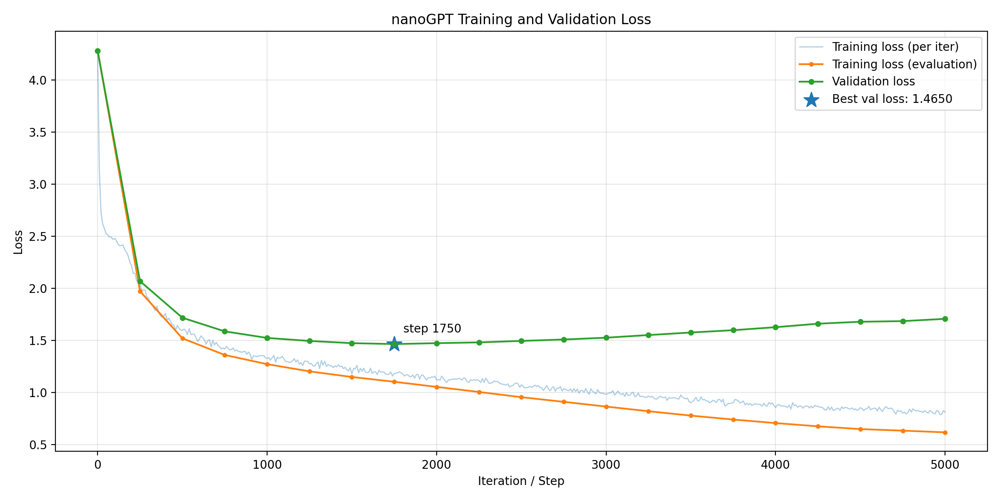
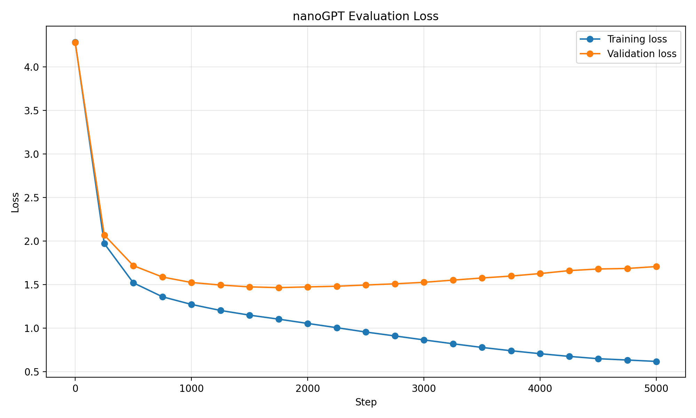

# Task3 部署并训练 nanoGPT

我选择了莎士比亚字符级训练即 Shakespeare char。

## 1. 环境部署

我用 AutoDl 租借了云端服务器，以下是环境版本和设备配置：
PyTorch ： 2.8.0
Python ： 3.12(ubuntu22.04)
CUDA ：12.8
GPU ：vGPU-32GB(32GB) \* 1
CPU ：12 vCPU Intel(R) Xeon(R) Platinum 8352V CPU @ 2.10GHz
内存：62GB
硬盘：系统盘:30 GB、数据盘:免费:50GB 付费:0GB

【进阶】：
n_layer = 6
n_head = 6
n_embd = 384
block_size = 256
batch_size = 64
learning_rate = 1e-3（warmup 学习率，这里是最大的学习率数值，实际 lr 随iter先增大后减小，最小的数值通常是它的十分之一。）
max_iters = 5000

## 2. 数据的准备 prepare.py

数据的准备由 prepare.py 文件完成，我用了 Shakespeare_char 里的 prepare：

- 找到输入文件 input.txt 的路径，如果没有就下载一个；
- 构建词表：找出所有不同字符，排成词表。这里采用字符级语言模型，即以单个字符作为词元；
- 建立字符与索引之间的映射；
- 划分训练集、验证集，并编上 ID；
- 将数组保存成 train.bin 和 val.bin，保存 meta 字典。

## 3. 训练结果

### 训练日志（部分截图）及loss曲线：





### 4. 生成文本：

```
root@autodl-container-9el52ll8z4-8344485b:~/autodl-tmp/jqy/nanoGPT-master# python sample.py \
    --out_dir=out-shakespeare-char \
    --start="ROMEO:" \
    --num_samples=3 \
    --max_new_tokens=200
Overriding: out_dir = out-shakespeare-char
Overriding: start = ROMEO:
Overriding: num_samples = 3
Overriding: max_new_tokens = 200
number of parameters: 10.65M
Loading meta from data/shakespeare_char/meta.pkl...
ROMEO:
No; but this is a pursuing to
be set boar to take and strange and barriage.

DUKE VINCENTIO:
Now, every rude.

Provost:
I must be some further to make dispatch mine.

DUKE VINCENTIO:
What says you? h
---------------
ROMEO:
And in the spel ling of his husband with his
rights have for's name.

POLIXENES:
Here's not the makes already her eyes, we'll
take it a gentleman of him.

CAMILLO:
No noble lordship in his shroud pin
---------------
ROMEO:
More worship.

CAMILLO:
Why, sir!

ANGELO:
What's he?

ESCALUS:
I have beard no more stoop of the world to see
me yourself what you shall have so put your swift.

ELBOW:
One till what we cannot be sc
---------------
```

## 5. 实验分析

- loss的变化：训练集loss一直下降，下降先快后缓；但是验证集loss先降后升，有轻微过拟合。
- 模型的变化：已经可以生成简单的语录，出现部分符合语法、有实际语义的句子。
  例如"I must be some further to make dispatch mine."其实还有点意思。
  **我还把这句小 GPT 生成的话喂给了老 GPT 翻译：**

  > 如果按照莎士比亚戏剧中略带古典色彩的语气，可以意译为：
  > “我还须再进一步，方能完成此事。”

- n_layer：控制 Transfomer 的 block 循环个数；
  n_head：注意力头数；
  n_embd：词嵌入的嵌入维度数。

- Train loss 反映训练集损失，用于反向传播找梯度、是模型优化的目标；Validation loss 反映验证集的损失，用于评估模型面对新样本的预测能力。通过两者比较可以判断是否有过拟合情况。
